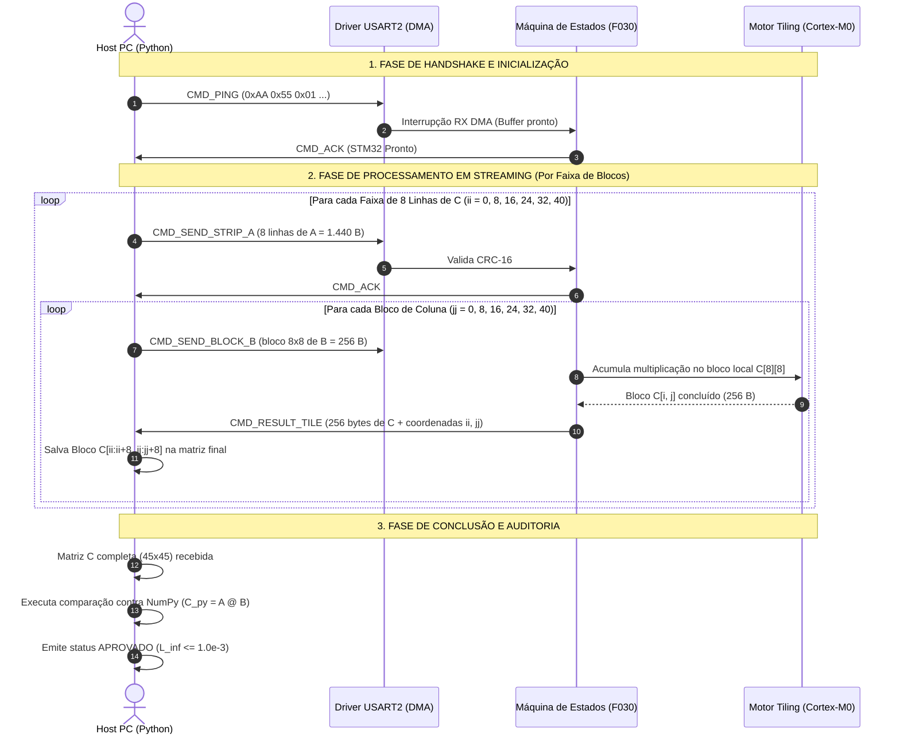

# 🛰️ Arquitetura de Comunicação Serial em Tempo Real (Hardware-in-the-Loop)
## Multiplicação de Matrizes com Tiling no STM32 sob Restrição de 8 KB de SRAM

> **Documento de Arquitetura e Engenharia de Sistema (Tarefa 2)**  
> **Modelo Operacional:** Co-processador Acelerador Bare-Metal (*Hardware-in-the-Loop* / HIL)  
> **Canal de Comunicação:** UART / VCP (*Virtual COM Port*) via USB (ST-LINK)  
> **Plataforma Alvo:** NUCLEO-F030R8 (ARM Cortex-M0, 8 KB SRAM nativa, 64 KB Flash)  
> **Host:** PC (Python com `pyserial` e `numpy`)

---

## 1. Visão Geral e Justificativa de Engenharia

Na nova arquitetura, o microcontrolador STM32 deixa de usar entradas fixas compiladas em Flash (`test_data.h`) e passa a operar como um **co-processador acelerador em tempo real**:
1. O **PC (Host)** envia múltiplos pares de matrizes de entrada ($A_k$ e $B_k$, com $N = 45$) sequencialmente através da porta serial.
2. A **placa STM32** recebe os dados pela UART, processa a multiplicação através do algoritmo de **Tiling ($B=8$)** sem estourar os **8 KB de SRAM**, e devolve a matriz resultante $C_k$ de volta pela serial para o PC.
3. O **PC** recebe $C_k$ em tempo real, valida contra o gabarito do NumPy ($C_{py} = A_k \times B_k$) e emite o laudo de conformidade para múltiplos casos de teste sem necessidade de recompilar ou regravar a memória Flash do microcontrolador.

### Principais Vantagens Desta Abordagem:
* **Testes Ilimitados:** Permite testar todos os 30 casos estatísticos + casos unitários (Identidade, Zeros, Forçada) sem alterar o firmware.
* **Preservação do Hardware:** Elimina o desgaste de ciclos de escrita (*endurance*) da memória Flash do microcontrolador.
* **Aplicações no Mundo Real:** Replica fielmente a arquitetura de aceleradores embarcados (ex: edge AI, processamento de sinais e DSP via barramento serial/SPI).

---

## 2. O Desafio Crítico de Memória: Como Transmitir $24{,}3\text{ KB}$ em 8 KB de RAM?

### 2.1 A Impossibilidade Matemática da Abordagem Ingênua

Se tentássemos receber a matriz $A$ inteira, a matriz $B$ inteira e calcular $C$ inteira na memória RAM:
$$\text{Matriz } A: 45 \times 45 \times 4\text{ bytes} = 8.100\text{ bytes}$$
$$\text{Matriz } B: 45 \times 45 \times 4\text{ bytes} = 8.100\text{ bytes}$$
$$\text{Matriz } C: 45 \times 45 \times 4\text{ bytes} = 8.100\text{ bytes}$$
$$\text{Total Necessário} = 8.100 + 8.100 + 8.100 = \mathbf{24.300\text{ bytes}}\ (\approx 23{,}7\text{ KB})$$

Como a placa **NUCLEO-F030R8 possui apenas 8.192 bytes (8 KB) de SRAM**, armazenar as 3 matrizes completas causaria um **estouro de memória fatal** (*Stack/RAM Overflow* imediato).

---

### 2.2 A Solução Arquitetural: Streaming de Faixas de Blocos (*Tile-Strip Streaming*)

Para resolver essa restrição mantendo o algoritmo de Tiling ($B=8$), a comunicação serial é particionada em **faixas horizontais de blocos**:

Para calcular uma **faixa horizontal de blocos** de $C$ de tamanho $8 \times 45$ (8 linhas completas de $C$ = 64 floats $\times$ 6 blocos = 1.440 bytes):
1. O STM32 necessita apenas de **8 linhas da matriz $A$** ($8 \times 45 \times 4 = 1.440\text{ bytes}$).
2. O STM32 necessita das colunas correspondentes de $B$, recebidas em blocos $8 \times 8$ sob demanda.
3. Conforme cada bloco $8 \times 8$ de $C$ é calculado no buffer local de **256 bytes**, ele é **imediatamente transmitido pela UART de volta ao PC**, liberando a memória RAM!

#### Orçamento Detalhado da SRAM no STM32:

| Componente de Memória | Tamanho Alocado | Percentual da SRAM (8 KB) | Função |
| :--- | :---: | :---: | :--- |
| **Buffer de Recepção UART (DMA Ring Buffer)** | 512 bytes | 6.25% | Recepção contínua sem perda de bytes (*overrun*) |
| **Buffer da Faixa Ativa de $A$ ($8 \times 45$ floats)** | 1.440 bytes | 17.58% | Linhas ativas da matriz $A$ em processamento |
| **Buffer do Bloco Ativo de $B$ ($8 \times 8$ floats)** | 256 bytes | 3.12% | Sub-bloco de $B$ em produto escalar |
| **Buffer do Bloco Resultante $C$ ($8 \times 8$ floats)** | 256 bytes | 3.12% | Sub-bloco de $C$ sendo acumulado e transmitido |
| **Variáveis Globais do Sistema e HAL** | ~350 bytes | 4.27% | Handles de UART, timers, máquina de estados |
| **Pilha do Sistema (*Stack*)** | 1.024 bytes | 12.50% | Chamadas de funções e variáveis locais |
| **SRAM LIVRE DE SEGURANÇA** | **~4.354 bytes** | **53.16%** | **Margem de segurança superior a 50%!** |

---

## 3. Topologia Física e Camada de Transporte (UART)

Na placa **NUCLEO-F030R8**, a comunicação física utiliza o circuito integrado do programador ST-LINK v2.1 através dos pinos da **USART2**:
* **Pino PA2 (USART2_TX):** Transmite do STM32 para o PC (RX do PC).
* **Pino PA3 (USART2_RX):** Recebe dados do PC (TX do PC).
* O chip ST-LINK converte esses pinos para a porta serial virtual USB (**Virtual COM Port - VCP**), visível no Gerenciador de Dispositivos do Windows como `COMx` (ex: `COM7`).

```text
+-----------------------+                         +-----------------------------------+
|      HOST PC          |                         |       NUCLEO-F030R8               |
|                       |                         |                                   |
|   Python Script       |       Cabo USB          |   +-------------+                 |
|   (pyserial)          | <=====================> |   | ST-LINK VCP |                 |
|                       |    (Virtual COM Port)   |   +------+------+                 |
|                       |                         |          | PA2 (TX) / PA3 (RX)    |
|   - Lê A_k e B_k      |                         |          v                        |
|   - Envia Frames      |                         |   +-------------+                 |
|   - Recebe C_k        |                         |   |   USART2    |                 |
|   - Valida com NumPy  |                         |   |  (com DMA)  |                 |
+-----------------------+                         +---+-------------+-----------------+
```

### Configuração da Porta Serial:
* **Baud Rate:** **`460.800 bps`** (ou `115.200 bps` para robustez máxima).
  * A 460.800 bps: $8.100\text{ bytes} \times 10\text{ bits} \approx 175\text{ ms}$ de tempo de transmissão por matriz completa.
* **Data bits:** 8 bits
* **Parity:** None
* **Stop bits:** 1 bit
* **Flow Control:** None (controle de fluxo garantido pelo protocolo de pacotes com ACK).

---

## 4. Definição do Protocolo Binário de Comunicação (Frame Specification)

Para garantir imunidade a ruídos, sincronização perfeita e integridade de dados, a comunicação adota um protocolo em pacotes binários com delimitador de início (*Start of Frame - SOF*) e soma de verificação (*CRC-16*):

```text
+----------+----------+----------+----------+-----------------------+----------+
|  SOF (2) | CMD (1)  | SEQ (1)  | LEN (2)  |   PAYLOAD (LEN bytes) | CRC (2)  |
+----------+----------+----------+----------+-----------------------+----------+
 0xAA 0x55   Comando    Sequência  Tamanho         Dados Binários     CRC-16-CCITT
```

### 4.1 Campos do Pacote:
1. **SOF (2 bytes):** `0xAA 0x55` — Marcador fixo de sincronismo para recuperar o alinhamento caso haja perda de bytes.
2. **CMD (1 byte):** Identificador da ação:
   * `0x01` (`CMD_PING`): Teste de conectividade / Handshake inicial.
   * `0x02` (`CMD_START_TEST`): Início de nova matriz (parâmetros: Test ID, N=45, B=8).
   * `0x03` (`CMD_SEND_ROW_STRIP`): Envio de 8 linhas da matriz $A$ (1.440 bytes) ou bloco de $B$.
   * `0x04` (`CMD_RESULT_TILE`): STM32 devolve um bloco $8 \times 8$ computado de $C$ (256 bytes).
   * `0x06` (`CMD_ACK`): Confirmação positiva de recebimento e validação do CRC.
   * `0x07` (`CMD_NACK`): Erro de integridade ou pacote fora de ordem (solicita retransmissão).
3. **SEQ (1 byte):** Número sequencial do pacote (0 a 255) para detectar perda de frames.
4. **LEN (2 bytes, Little-Endian):** Tamanho do payload em bytes.
5. **PAYLOAD (Variável):** Dados numéricos em `float32` (IEEE 754 binário).
6. **CRC (2 bytes):** Checksum CRC-16-CCITT calculado sobre `CMD + SEQ + LEN + PAYLOAD`.

---

## 5. Diagrama de Sequência da Comunicação (Host $\leftrightarrow$ STM32)



---

## 6. Arquitetura do Firmware no STM32

O firmware adota uma arquitetura não-bloqueante orientada a interrupções e DMA:

```text
+-----------------------------------------------------------------------------------+
|                            FIRMWARE STM32 (NUCLEO-F030R8)                         |
|                                                                                   |
|  +---------------------+        +--------------------+        +----------------+  |
|  |  USART2 RX com DMA  | -----> | Máquina de Estados | -----> | Motor Tiling   |  |
|  |  Circular (512 B)   |        |     (Parser FSM)   |        | (SRAM 256 B)   |  |
|  +---------------------+        +--------------------+        +----------------+  |
|                                           |                           |           |
|                                           v                           v           |
|                                 +--------------------+        +----------------+  |
|                                 | LED Status (PA5)   |        | USART2 TX DMA  |  |
|                                 | Pisca em dados     | <----- | Resposta C_tile|  |
|                                 +--------------------+        +----------------+  |
+-----------------------------------------------------------------------------------+
```

### 6.1 Máquina de Estados Finitos (FSM) do Parser Serial:
* **`STATE_WAIT_SOF1`:** Aguarda o primeiro byte delimitador (`0xAA`).
* **`STATE_WAIT_SOF2`:** Confirma o segundo byte delimitador (`0x55`).
* **`STATE_READ_HEADER`:** Lê os 4 bytes de controle (`CMD`, `SEQ`, `LEN_L`, `LEN_H`).
* **`STATE_READ_PAYLOAD`:** Preenche o buffer de dados até completar `LEN` bytes via DMA.
* **`STATE_VERIFY_CRC`:** Calcula o CRC-16 do pacote recebido. Se válido, despacha para processamento; se inválido, envia `CMD_NACK`.
* **`STATE_COMPUTE`:** Dispara a rotina de multiplicação de matriz do bloco.
* **`STATE_TRANSMIT_RESULT`:** Envia o resultado de volta ao PC via DMA TX sem travar a CPU.

---

## 7. Arquitetura do Módulo Host no PC (Python)

No computador, um script mestre automatizado gerencia todo o ciclo de testes:

```text
src_t2/
├── runner_serial.py            # Orquestrador Serial Host (envia testes, recebe C, audita)
├── protocolo_serial.py         # Encoder/Decoder de frames binários e cálculo de CRC-16
├── framework_testes.ipynb      # Caderno de análise gráfica e relatório final
└── audit/                      # Laudos consolidados (CSV e JSON de todos os testes)
```

### Funcionamento do Runner Python:
1. **Auto-Discovery da Porta:** Varre as portas seriais e detecta automaticamente a `STMicroelectronics STLink Virtual COM Port`.
2. **Handshake de Conexão:** Envia `CMD_PING` e confirma que a placa STM32 está online e responsiva.
3. **Loop Estatístico de Testes (1 a 30):**
   ```python
   for teste_id in range(1, 31):
       A = carregar_matriz(f"src_t1/input_matrix/A_{teste_id}.bin")
       B = carregar_matriz(f"src_t1/input_matrix/B_{teste_id}.bin")
       
       # Envia para a placa e recebe C_stm32 via UART streaming
       C_stm32 = processar_remoto_stm32(porta_serial, A, B)
       
       # Validação matemática imediata com NumPy
       C_py = np.matmul(A, B, dtype=np.float32)
       erro_max = np.max(np.abs(C_stm32 - C_py))
       assert erro_max <= 1.0e-3, f"Teste {teste_id} falhou com erro {erro_max}"
   ```
4. **Geração Consolidada de Relatórios:** Produz gráficos de tempo de resposta (*latency*), vazão (*throughput*) e conformidade metrológica de 100% dos testes.

---

## 8. Comparativo: Arquitetura Anterior (Flash IAP) vs. Nova Arquitetura (Serial Streaming)

| Métrica / Recurso | Arquitetura Anterior (Flash IAP) | Nova Arquitetura (Serial Streaming) |
| :--- | :--- | :--- |
| **Fonte das Entradas $A$ e $B$** | Gravadas na Flash (`test_data.h`, estático) | Transmitidas dinamicamente do PC via USB/UART |
| **Capacidade de Testes** | 1 teste por compilação | **Testes infinitos em sequência (30 estatísticos + 3 unitários)** |
| **Tempo para Rodar 30 Testes** | Horas (exigia recompilar e regravar a placa 30 vezes) | **Poucos segundos em loop automatizado contínuo** |
| **Consumo de SRAM** | 256 bytes para cálculo | ~2.5 KB (buffers UART DMA + Tiling, cabe nos 8 KB) |
| **Desgaste da Flash** | 8 KB gravados a cada execução | **0 gravações na Flash (vida útil do silício preservada)** |
| **Sinalização Visual** | LED acende ao final do único teste | LED pulsa a cada pacote transmitido/recebido |
| **Validação** | Extração manual/post-mortem da Flash | **Validação em tempo real elemento a elemento** |

---

## 9. Plano de Ação para Implementação

1. **Passo 1 (Firmware STM32):**
   - Configurar no STM32CubeMX a `USART2` com baud rate de `460.800 bps` e canais DMA de RX e TX.
   - Implementar o parser de pacotes binários (`protocolo.c` e `protocolo.h`) com validação de CRC-16.
   - Conectar o motor de multiplicação `multi_tiling.c` para operar com os buffers da UART.
2. **Passo 2 (Host PC):**
   - Implementar o script Python de transporte serial (`src_t2/runner_serial.py`).
   - Implementar o empacotamento com CRC-16 em Python.
3. **Passo 3 (Bateria de Validação Automatizada):**
   - Executar os 30 casos de teste sequenciais pela serial e comprovar a aprovação de 100% com erro $\le 1{,}0 \times 10^{-3}$.
